# Learning Management System

Final project for Full Stack Front End Development.

Built using Django, Django REST Framework (DRF), JWT Authentication, React and SQLite.

## deployment
frontend URL: https://learning-management-system-frontend-c7jz.onrender.com/
Due to the SQLite server it is not possible to keep the DB when re deploying.
For this reason I decided that the 1st user to sign up is always an admin, this way I can create the first account after deployment and always have admin rights.

## Features

### Students
- Register to courses
- Deregister from courses
- View enrolled courses
- Update own profile

### Teachers
- Create courses
- Update owned courses
- View users
- Update own profile

### Administrators
- Create staff accounts and student accounts
- Manage all users
- Manage all courses
- Update own profile (but can't delete/update last admin)


### additional constraints
- If a course is deleted, the students will automatically be deregistered
- A teacher/admin can not be deleted as long as there is a course assinged to them.

### Examples screenshots of the application
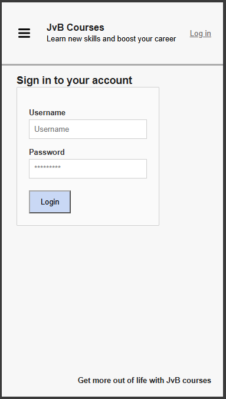
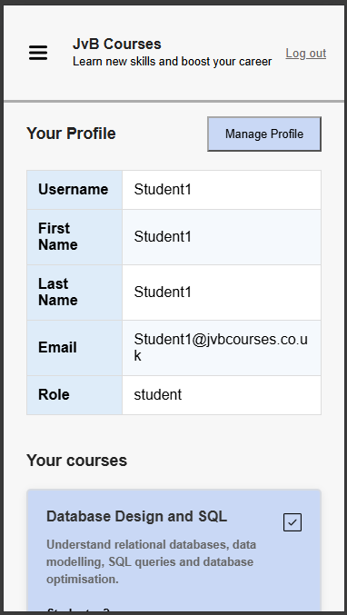
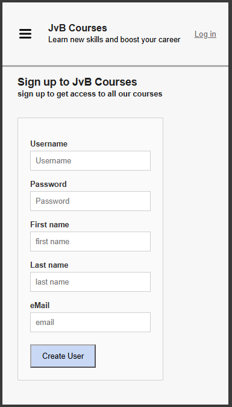
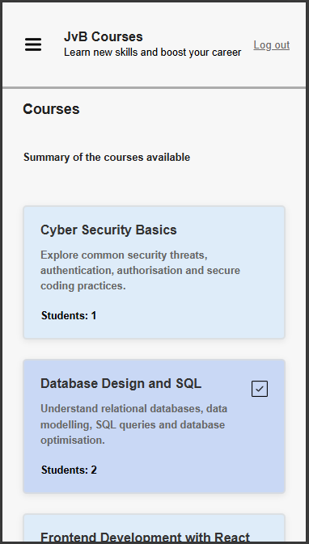
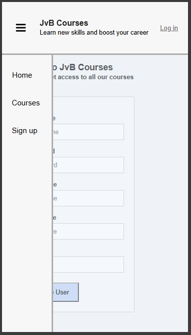


## Tech Stack

### Backend
- Python
- Django
- Django REST Framework
- Simple JWT
- SQLite

### Frontend
- JavaScript
- React
- React Router

## Testing and Code Quality
- Jest
- React Testing Library
- Flake8
- ESLint
- W3C

## External Libraries and Frameworks
- React - Frontend JavaScript library https://react.dev/
- React Router - Client-side routing https://reactrouter.com/
- Jest - Unit testing framework https://jestjs.io/
- React Testing Library - React component testing https://testing-library.com/
- Django - Python web framework https://www.djangoproject.com/
- Django REST Framework - REST API framework for Django https://www.django-rest-framework.org/
- Simple JWT - JWT authentication for Django REST Framework https://django-rest-framework-simplejwt.readthedocs.io/
- Flake8 - Python code linting https://flake8.pycqa.org/
- ESLint - JavaScript and React code linting https://eslint.org/

## Run the Project

### Clone repository
```bash
git clone https://github.com/JakevB88/learning-management-system.git
```

### Install frontend dependencies
```
cd frontend
npm install
```

### Run React frontend
```
npm start
```

### Install backend requirements
```
cd backend
pip install -r requirements.txt
```

### Run database migrations
```bash
python manage.py migrate
```

### Start development server
```bash
python manage.py runserver
```

### Create superuser
```bash
python manage.py createsuperuser
```

Follow the prompts to create an admin account.

You can then obtain a JWT token using the administrator credentials via:

```http
POST /api/token/
```
---

# Consuming the API
# Authentication

## Obtain JWT Token

### Endpoint

```http
POST /api/token/
```

### Request Body

```json
{
    "username": "admin",
    "password": "admin"
}
```

### Success Response

```json
{
    "access": "jwt-token",
    "refresh": "refresh-token"
}
```

### Authentication Header

```http
Authorization: Bearer <access_token>
```

---

# User Endpoints

## Get Current Profile

```http
GET /api/users/profile/
```

Permissions:
- Authenticated Users

---

## Get All Users

```http
GET /api/users/
```

Permissions:
- Admin
- Teacher

---

## Get User By ID

```http
GET /api/users/{user_id}/
```

Permissions:
- Admin
- Teacher

Example:

```http
GET /api/users/1/
```

---

## Create Student Account

```http
POST /api/users/create/
```

Permissions:
- Public

Request Body:

```json
{
    "username": "student1",
    "password": "password",
    "first_name": "John",
    "last_name": "Smith",
    "email": "john@example.com"
}
```

---

## Create Staff Account

```http
POST /api/users/create-staff/
```

Permissions:
- Admin

Request Body:

```json
{
    "username": "teacher1",
    "password": "password",
    "first_name": "John",
    "last_name": "Smith",
    "email": "john@example.com",
    "role": "teacher"
}
```

Allowed roles:

```json
[
    "teacher",
    "admin"
]
```

---

## Update User

```http
PATCH /api/users/{user_id}/update/
```

Permissions:
- Account Owner
- Admin

Example:

```http
PATCH /api/users/2/update/
```

---

## Delete User

```http
DELETE /api/users/{user_id}/remove/
```

Permissions:
- Admin

Example:

```http
DELETE /api/users/2/remove/
```

---

# Course Endpoints

## Get All Courses

```http
GET /api/courses/
```

Permissions:
- Public

---

## Get Course By ID

```http
GET /api/courses/{course_id}/
```

Permissions:
- Public

Example:

```http
GET /api/courses/1/
```

---

## Create Course

```http
POST /api/courses/create/
```

Permissions:
- Teacher
- Admin

Request Body:

```json
{
    "title": "Python Fundamentals",
    "description": "Introduction to Python"
}
```

---

## Update Course

```http
PATCH /api/courses/{course_id}/update/
```

Permissions:
- Course Owner
- Admin

Example:

```http
PATCH /api/courses/1/update/
```

---

## Delete Course

```http
DELETE /api/courses/{course_id}/remove/
```

Permissions:
- Course Owner
- Admin

Example:

```http
DELETE /api/courses/1/remove/
```

---

# Course Registration

## Register For Course

```http
PUT /api/courses/{course_id}/register/
```

Permissions:
- Student

Example:

```http
PUT /api/courses/1/register/
```

---

## Deregister From Course

```http
PUT /api/courses/{course_id}/deregister/
```

Permissions:
- Student

Example:

```http
PUT /api/courses/1/deregister/
```

---

## Admin Deregister Student From Course

```http
PUT /api/courses/{course_id}/deregister-admin/
```

Permissions:
- Admin

Request Body:

```json
{
    "student_id": 2
}
```

Example:

```http
PUT /api/courses/1/deregister-admin/
```

---

## Permissions table Summary

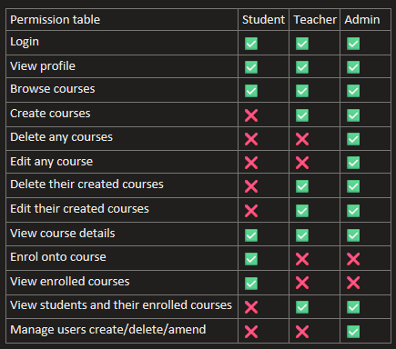


---

## Testing

### Manual backend tests
Once the backend view.py was build I created REST CRUD tests in the directory "backend/api_tests" to manually validate the API.
I tracked the results in the permissions table.

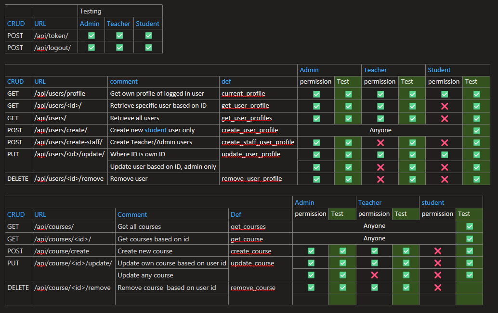

### Frontend automated testing
**$ npm test -- --coverage --watchAll=false**

Run this inside the frontend directory to run all test.js files in the frontend directory.

Screenshot showing the results.

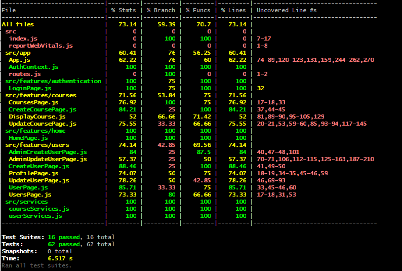


### Backend automated testing
**$ python -m coverage run manage.py test**

**$ python -m coverage report**

Run these 2 commands to run all the tests set out in tests.py and to see the covverage of these tests

Screenshot showing the results:

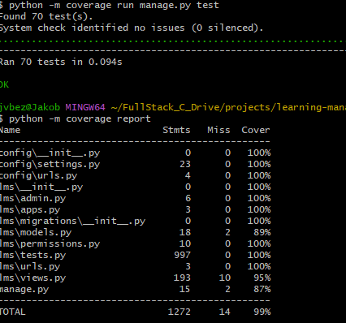

### Code validation

#### Backend validation Django Python
Flake8 was used to check
- views.py
- tests.py
- models.py
- urls.py
- permissions.py

All functionall issues (unused imports/variables) have been corrected.
All the remaining issues are linelength or comment related spacing.

#### Frontend validation Javascript & CSS
estlint was used to check all code nested in the src directory.

CSS validation with W3C
W3C CSS validation reported a single asset loading warning relating to the dropdown icon image reference.
When the external image reference is temporarily removed, the stylesheet validates successfully with no reported CSS errors.


---

## Wireframes
### Initial wireframes for:
- home page
- Login page
- Profile page student
- course page student
- Profile page Teacher
- manage course Teacher
- users page Teacher
- Profile page Admin
- manage course page admin
- users page admin
- manage user admin

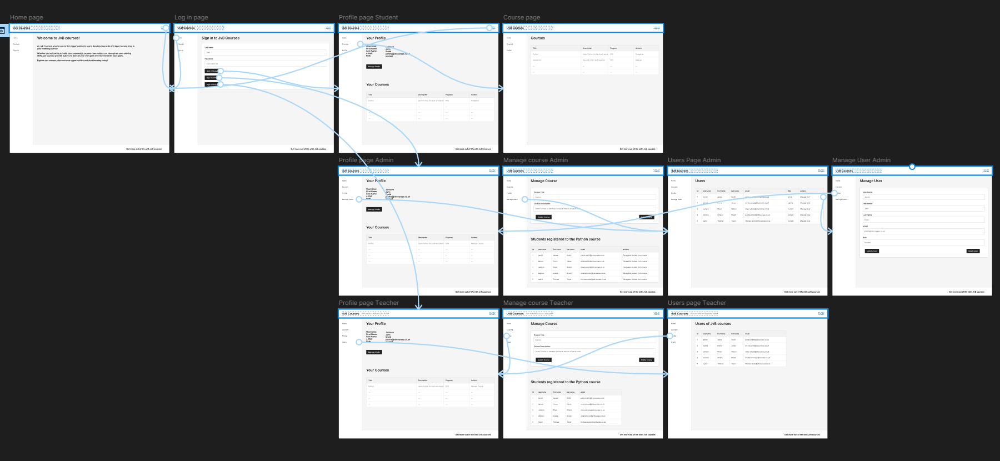
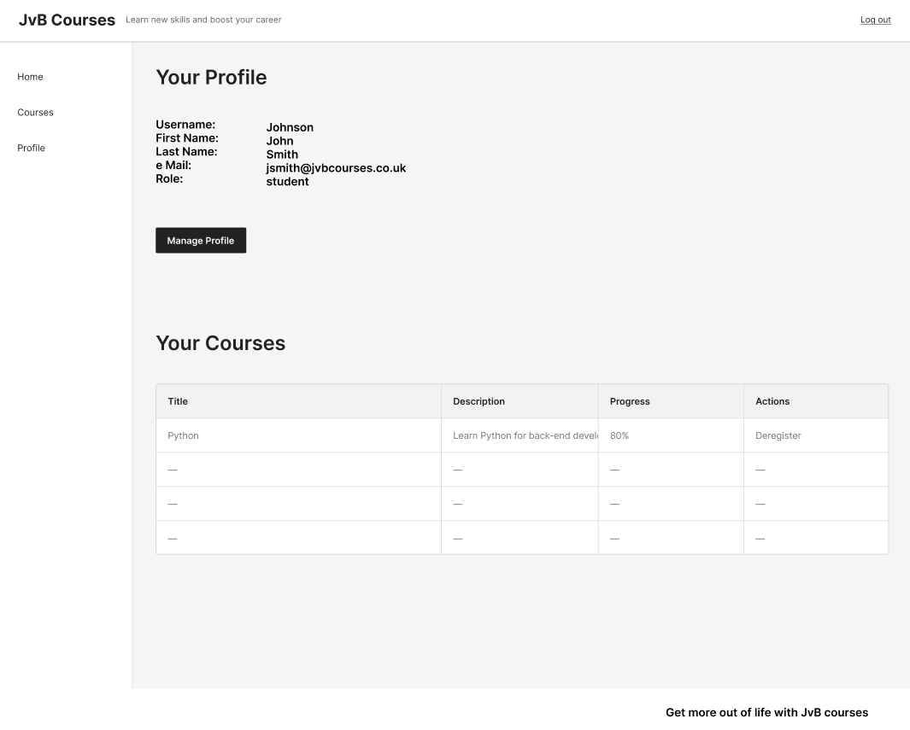
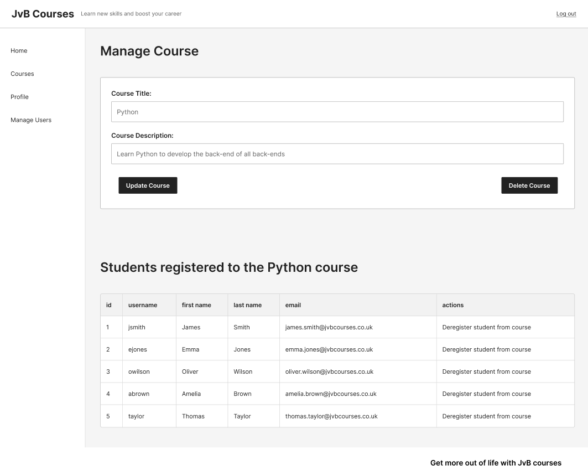
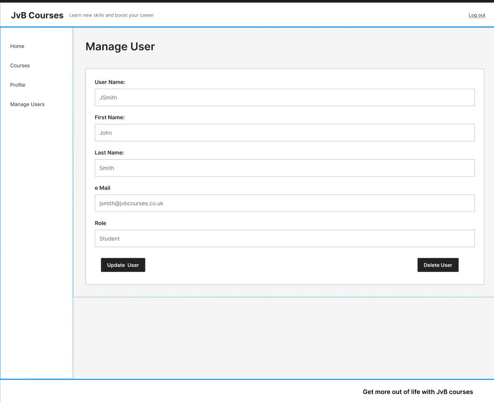

After creating the frontend based on these wireframes it was clear that the tables are not very responsive for small screens.
It was then decided to display the courses as tiles instead for better responsiveness
The tables for users staid but the column count is reduced and each column can be clicked to navigate to a page with more detail on that specific user.

---

## Refferences
- dropdown.png            https://uxwing.com/arrow-thin-chevron-bottom-icon/
- burgermenu.png          https://uxwing.com/three-horizontal-lines-icon/
- dropdown.png            https://uxwing.com/line-angle-down-icon/
- tick-icon.png           https://uxwing.com/check-mark-box-line-icon/

### Use of AI Tools
Microsoft Copilot was used during the development of this project to:
- Explain React, Django, and Django REST Framework concepts
- Assist with debugging and troubleshooting
- Suggest code refactoring and project structure improvements
- Generate examples of unit tests
- Explain error messages
- Review code
